

  

<h1 align="center">Wheel</h1>

  <b>Convert, edit and combine files without opening a single app.</b> 
  Drag a file, hold <kbd>Shift</kbd>, drop it on a slice. Done.

  
  
  
  
  

  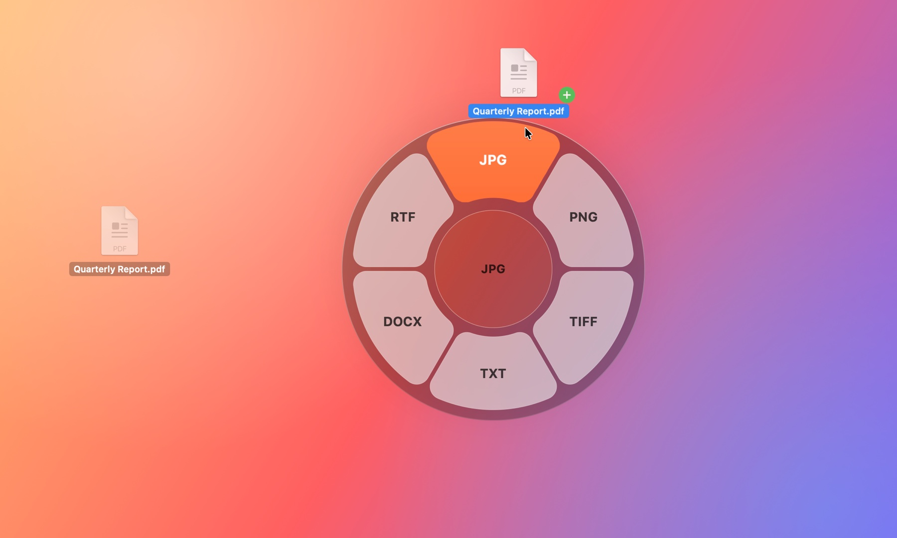

You've done the dance: open Preview, export, pick a format, find the file, rename it. Or upload a private PDF to a "free online converter". **Wheel skips all of that.** Start dragging any file from Finder or your Desktop and hold Shift. A wheel of options pops up under your cursor; let go over one. The new file appears right next to the original.

- **Fast:** one drag, one drop. No windows, no menus, no save dialogs.
- **Private:** everything happens on your Mac. Wheel has no network code at all.
- **Safe:** your original is never changed. Wheel always writes a new file beside it.
- **Free and open source** (MIT). No account, no subscription, no ads.

<a href="https://github.com/K0alalalala/Wheel/releases/latest"><b>⬇︎ Download Wheel for Mac</b></a> · <a href="#install">How to install</a> · <a href="#faq">FAQ</a>

---

## How it works

1. **Start dragging** a file (or several) from Finder or the Desktop.
2. **Hold <kbd>Shift</kbd>.** A wheel appears under the cursor, with options that fit that file type.
3. **Drop it on a slice.** A small toast shows progress. Click it to see the result in Finder.

The centre of the wheel switches between three wheels: **Convert**, **Edit** and, when you drag more than one file, **Combine**. Rest on the centre for a moment, or press firmly on a Force Touch trackpad.

<table>
  <tr>
    <td align="center" width="33%">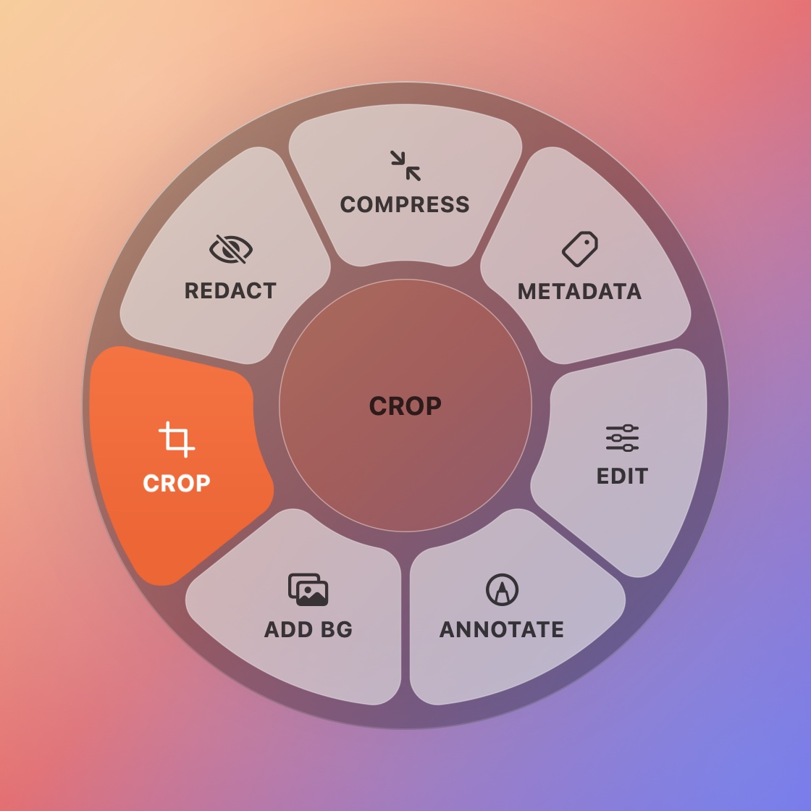 <b>Edit</b> a photo</td>
    <td align="center" width="33%">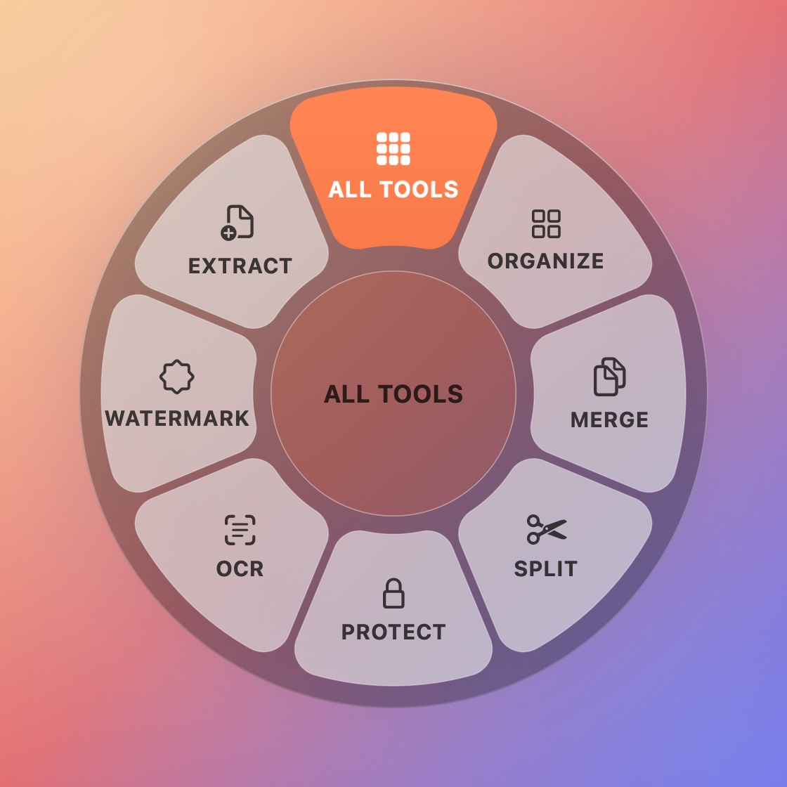 <b>PDF tools</b></td>
    <td align="center" width="33%">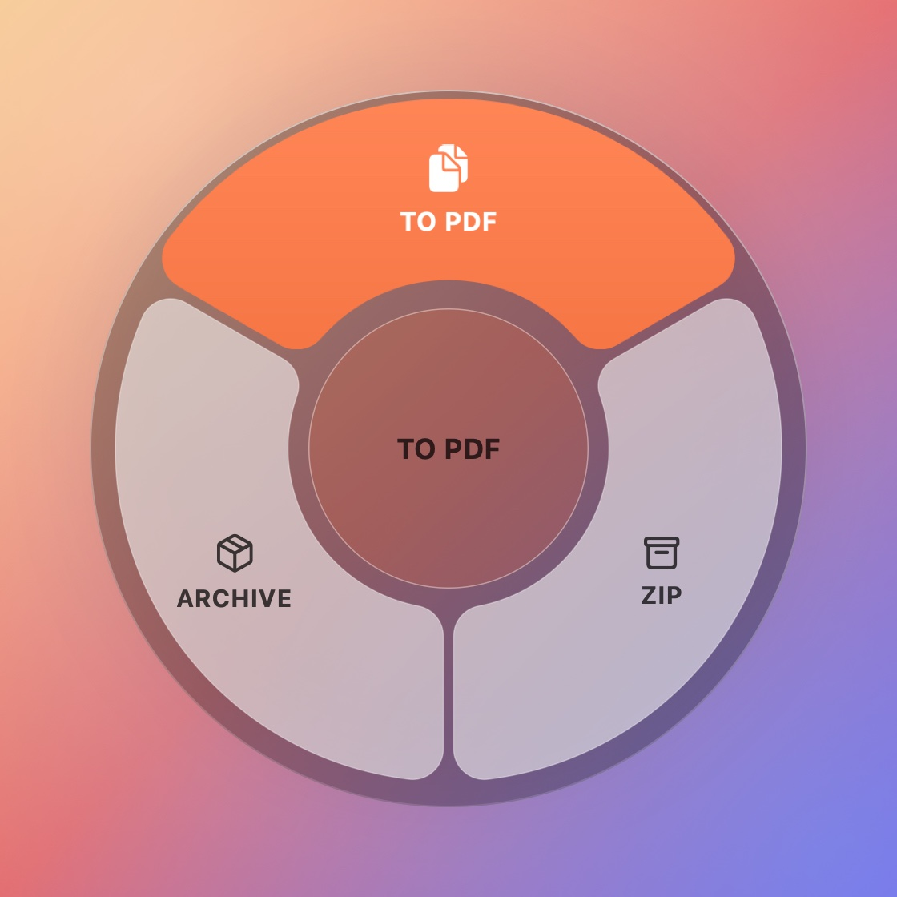 <b>Combine</b> several files</td>
  </tr>
</table>

## What it can do

### Convert anything into anything (almost)

| Drop a… | …and get |
|---|---|
| **Image** (PNG, JPG, HEIC, WEBP, TIFF, BMP, GIF, AVIF) | PNG · JPG · WEBP · HEIC · TIFF · AVIF · BMP · PDF |
| **PDF** | JPG · PNG · TIFF (every page) · TXT · DOCX · RTF |
| **Document** (DOCX, TXT, Markdown, HTML, RTF) | PDF · DOCX · TXT · RTF · HTML |
| **Video** | MP4 · MOV · GIF · WEBM · M4A · MP3 |
| **Audio** | M4A · MP3 · WAV · AIFF · FLAC |

Drag 50 photos at once and convert them all in one drop. The wheel only shows formats that make sense, and leaves out the one the file is already in.

### Quick image edits

Crop, compress, adjust, annotate, redact, strip location data, or put a screenshot on a pretty background, each in a small focused window that saves a new copy.

  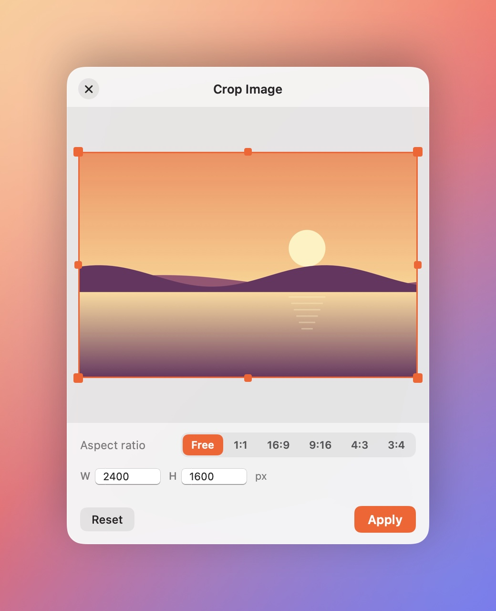
  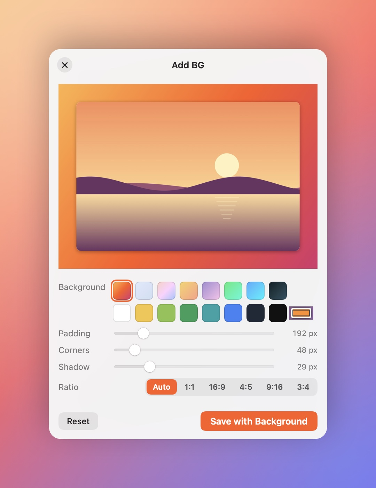
  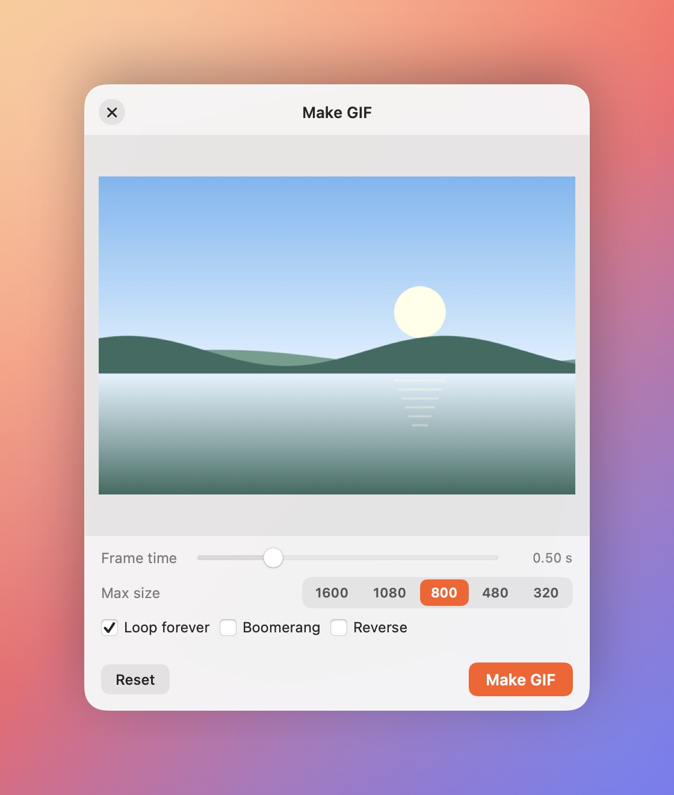

**Redact** destroys the pixels under the black boxes; it isn't just a layer on top. **Metadata** shows what a photo reveals (camera, date, GPS location) and saves a clean copy.

### A full PDF toolkit

Twenty PDF tools. The common ones sit on the wheel, and **All Tools** opens the rest.

- **Pages:** Organize (drag to reorder, rotate, duplicate, add blank pages), Delete pages, Extract pages, Split, Merge, Rotate, Reverse
- **Stamps:** Watermark, Page numbers
- **Security:** Protect with a password or block printing and copying; Unlock
- **Clean-up:** OCR (make scans searchable), Flatten, Grayscale, Trim margins, remove comments, 2-up printing, Compress, strip metadata

  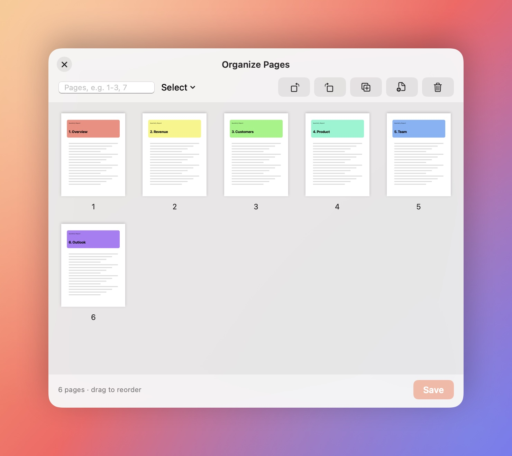
  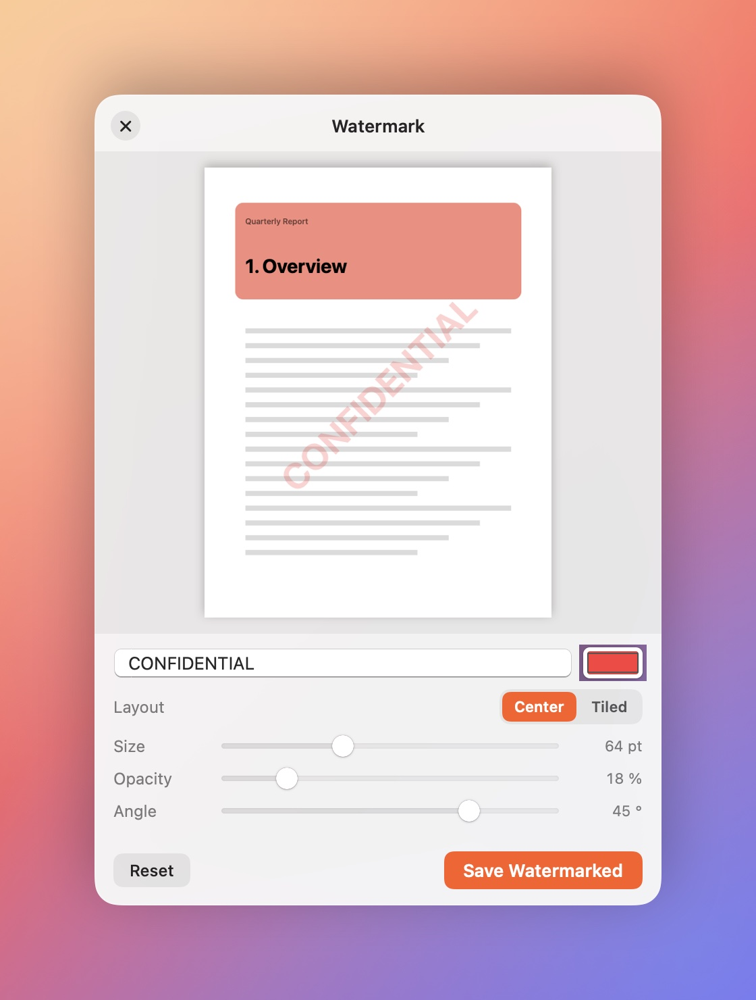

  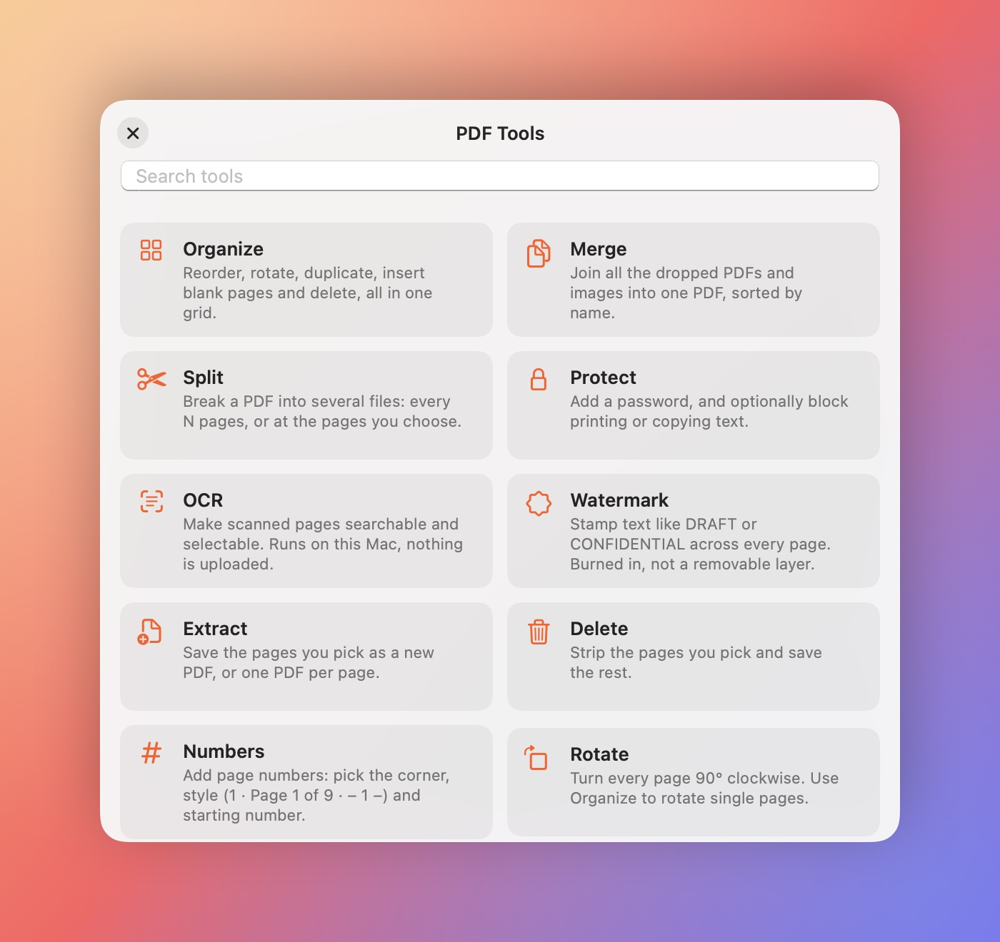

OCR uses Apple's on-device text recognition, so your scans never leave your Mac.

### Combine several files into one

Drag two or more files together and the **Combine** wheel opens:

- **To PDF:** PDFs, photos and documents become one PDF, in the order you choose
- **Zip** in one drop, or **Archive** as ZIP, TAR.GZ, 7Z or RAR
- **Stitch:** photos into one long image, a row or a grid
- **GIF:** photos into an animation
- **Join:** audio or video clips back to back

  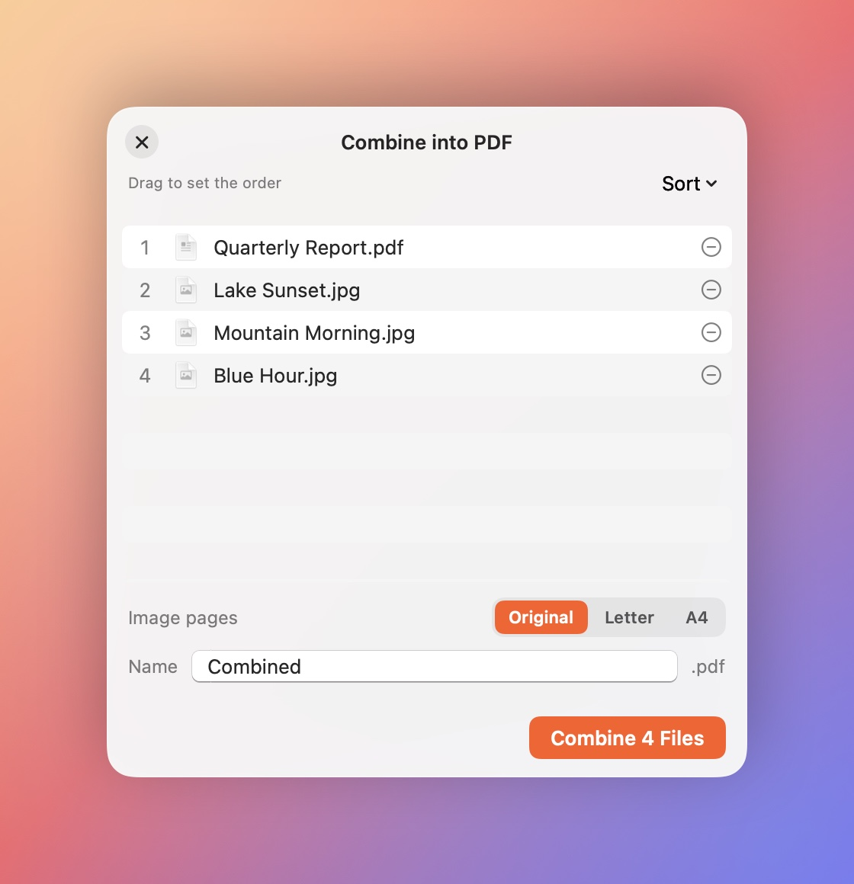

### Make it yours

Resize it, recolour it, reshape it. Pick one of nine presets or tweak every detail: size, shape, colours (including your Mac's accent colour), glass, fonts, animations, and which slices appear in what order. Share your look as a `.wheeltheme` file.

  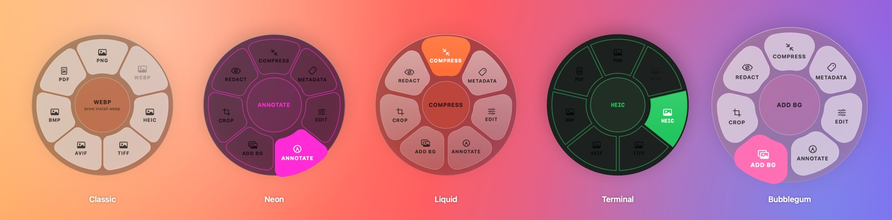

  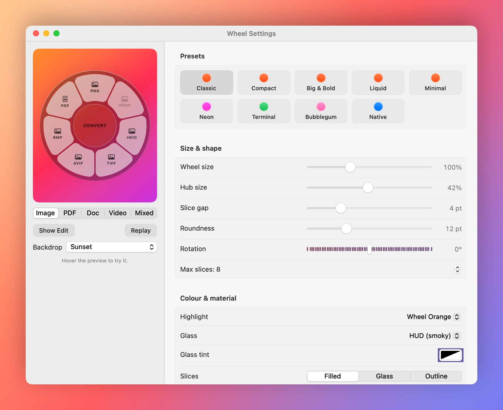

  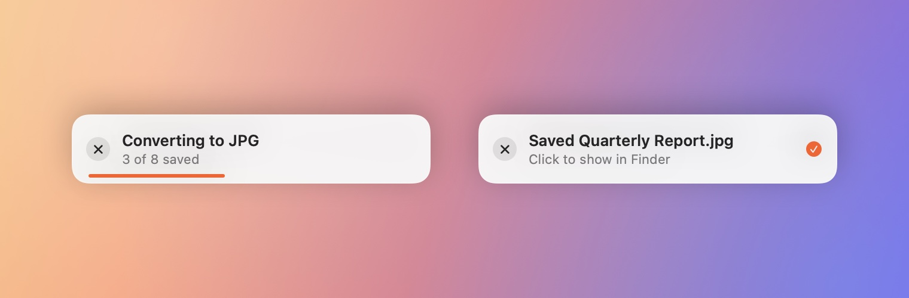

## Private by design

- **Nothing leaves your Mac.** Wheel has no network code: no uploads, no analytics, no update checks.
- **Your originals are untouched.** Every action writes a new file next to the source, named after it (`Report.pdf` → `Report.jpg`, `Report Cropped.jpg`…), and never overwrites anything.
- **A small, private log, only if you want it.** To help fix crashes, Wheel keeps a log in `~/Library/Logs/Wheel` that only you can read. It never records file contents, passwords or full paths, and hides file names unless you allow them. Turn it off in **Settings → General → Diagnostics**. [What's in the log?](#logs--crash-reports-local-only)
- **Open source.** You can read every line, or build it yourself.

## Install

1. **[Download the latest `Wheel-x.y.z.dmg`](https://github.com/K0alalalala/Wheel/releases/latest)** and open it.
2. **Drag Wheel into Applications.**
3. **Open Wheel.** macOS will say it can't verify the developer, because Wheel is free and isn't registered with Apple's paid developer program. To allow it, once:
   - **macOS 15 Sequoia or later:** open **System Settings → Privacy & Security**, scroll down, click **Open Anyway** next to the message about Wheel, and confirm.
   - **macOS 14 Sonoma:** in Applications, right-click Wheel → **Open** → **Open**.
4. A **◎** icon appears in your menu bar. That's Wheel. It starts automatically when you log in; you can change that in Settings.

**Requirements:** macOS 14 Sonoma or later, on an Apple Silicon or Intel Mac.

Each release lists a SHA-256 checksum, so you can check your download with `shasum -a 256 Wheel-x.y.z.dmg` if you like.

### Optional extras

Almost everything works out of the box. A few formats rely on free tools you can install with [Homebrew](https://brew.sh), a popular package manager for the Mac. Until you do, those slices are greyed out and show the command to run.

| For | Run in Terminal |
|---|---|
| WEBP images | `brew install webp` |
| MP3, FLAC, GIF and WEBM | `brew install ffmpeg` |
| 7Z archives | `brew install sevenzip` |
| RAR archives | `brew install --cask rar` |
| Nicer Markdown → PDF/DOCX | `brew install pandoc` |

**Settings → Tools** shows which ones Wheel found.

## FAQ

<b>Is it really free? What's the catch?</b>

No catch. Wheel is open source under the MIT license: free to use, change and share. There's no account, no tracking and nothing to upgrade to.

<b>Does Wheel upload my files anywhere?</b>

No. All conversions and edits, including text recognition (OCR), run on your Mac. Wheel contains no networking code, and you can check that in the source.

<b>Why does macOS warn me when I first open it?</b>

Apple asks developers to pay for a yearly certificate and submit apps for "notarization". Wheel is a free project and skips that, so macOS asks you to confirm once. The steps are under [Install](#install). The source is public, and each download has a checksum you can verify.

<b>Will it change or delete my original file?</b>

Never. Every action creates a new file next to the original. If a file with that name already exists, Wheel adds " 2", " 3" and so on rather than overwriting it.

<b>The wheel doesn't appear when I drag.</b>

- Make sure the ◎ menu-bar icon is there and **Enabled** is ticked in its menu.
- Hold the trigger key *while* dragging: Shift by default, or whatever you chose in Settings.
- Drag from Finder or the Desktop. Some apps (Mail attachments, Photos) hand over files in a way Wheel can't see yet. Save the file to a folder first.

<b>Does it need special permissions?</b>

No. Optionally, you can grant **Accessibility** so the <kbd>Esc</kbd> key can close the wheel mid-drag. The first-run screen explains it, and everything else works without it.

<b>Can I choose which options show up, or use a different key?</b>

Yes. In **Settings** you can pick the trigger key (Shift, Option, Control or Command), hide or reorder slices for each wheel, and change how the centre switches wheels.

<b>How do I uninstall it?</b>

Quit Wheel from its menu-bar icon and drag **Wheel** from Applications to the Trash. To remove its settings and logs too, delete `~/Library/Preferences/io.github.k0alalalala.wheel.plist` and `~/Library/Logs/Wheel`.

## Logs & crash reports (local only)

When something goes wrong, a little history helps. Wheel keeps a diagnostic log **only on your Mac**, in `~/Library/Logs/Wheel/`:

| File | What's in it |
|---|---|
| `wheel.log` (+ `wheel.1.log`, `wheel.2.log`) | Wheel and macOS versions, when the wheel opened, which option you chose, whether it worked, how long it took, and any errors |
| `crash-<date>.txt` | If Wheel crashes, a short technical summary of what happened |

- **Never logged:** file contents, passwords, full paths, your home folder or your name. File names show as `‹pdf›`, `‹jpg›` unless you turn on *Include file names*.
- **Protected:** only your account can read it. It's kept out of Time Machine and capped at a few MB, and old entries delete themselves after 14 days.
- **Your choice:** turn it off in **Settings → General → Diagnostics**, where you can also open the folder, copy recent entries, or delete everything.

**Reporting a problem?** Click **Copy Recent Log** in that same section, read it over, and paste it into a [new issue](https://github.com/K0alalalala/Wheel/issues/new). If you use an AI coding assistant (Claude Code, Codex and the like), you can ask it to look at `~/Library/Logs/Wheel/`; this repo tells it how.

## Known limits

- Some apps, like Mail attachments and Photos, don't hand over real files when you drag, so Wheel can't pick them up yet.
- Watermark, Page numbers, 2-Up and OCR redraw the pages, so PDF form fields and comments don't carry over. The visible page does.
- WEBP output, MP3/FLAC/GIF/WEBM, 7Z and RAR need the [optional extras](#optional-extras).

## Contributing

Ideas, bug reports and pull requests are welcome; please [open an issue](https://github.com/K0alalalala/Wheel/issues) first for big changes.

- **Building and extending Wheel:** [docs/DEVELOPING.md](docs/DEVELOPING.md)
- **Working with an AI coding agent:** point it at [AGENTS.md](AGENTS.md). Claude Code also reads `CLAUDE.md` and comes pre-configured to build and test.
- **Security issues:** please report privately; see [SECURITY.md](SECURITY.md).

<!-- credits:start (protected: see AGENTS.md) -->
## Credits

| | |
|---|---|
| **K0alalalala** | Visionary. Pasted one HTML file, typed "Continue", and asked for credits. Peak delegation. |
| **Claude** (Anthropic) | Wrote the code, the tests, the installer, the icon, and this joke. Then gave the human top billing. |
| **K0alalalala** | Executive Producer of Holding Shift. |
| **Claude** | Lead Wedge Geometrist. Has opinions about 2pt gaps. |

No humans were overworked in the making of this app. The same credits appear in the app under **About Wheel**.
<!-- credits:end -->

## License

[MIT](LICENSE): use it, change it, share it.
